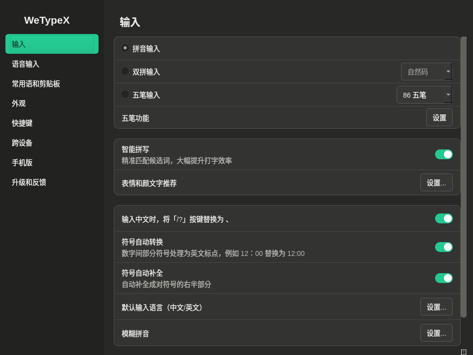
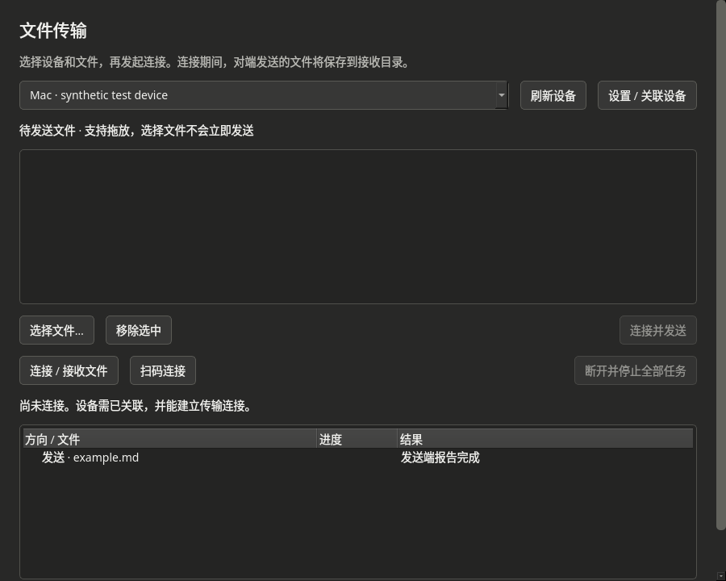

# WeTypeX Omarchy

**English** · [简体中文](README.zh-CN.md)

Chinese input, clipboard sync and file transfer for **Omarchy / Hyprland**, built on [WeTypeX](https://github.com/panxuc/fcitx5-wetypex).

Use Fcitx5 on Linux and keep the official WeType clients on Mac and iPhone. Neither Apple device needs an additional app or service.

**Current release:** [0.1.0-rc.2](https://github.com/eddieqiu79/wetypex-omarchy/releases/tag/v0.1.0-rc.2), a preview candidate. **Target:** Arch / Omarchy, x86_64. The official runtime is pinned separately to `2.2.3.657`.

[Install and update](docs/RELEASE-INSTALL.md) · [Desktop guide](docs/DESKTOP.md) · [Contribute](CONTRIBUTING.md) · [Licenses](LICENSES.md)

## Install and update

Start with the [release installation guide](docs/RELEASE-INSTALL.md). It covers environment checks, verified downloads, installation, activation and recovery. If an AI agent is doing the installation, give it this repository URL and ask it to follow [AGENTS.md](AGENTS.md) and [the installation checklist](docs/INSTALL.md).

- **Prebuilt Arch package:** use this fork's immutable GitHub Releases and the explicit `preview` channel. The stable channel currently has no release.
- **Build an Arch package:** follow [the source-package guide](docs/ARCH.md). The retained upstream AUR recipe installs upstream WeTypeX, not this fork.
- **Updates:** the package helper verifies release and asset attestations, hashes and package metadata. Installation uses an explicit pacman transaction. No pacman repository is configured, so `pacman -Syu` alone does not discover these releases.

The package contains the adapter and desktop applications. Obtain the official runtime separately under its applicable terms. Pairing, service activation and Fcitx restarts are separate setup steps. Existing private-prefix installations need migration review before installing a system package.

## What it does

### Chinese input and desktop settings

Fcitx5 integration uses WeTypeX's existing macOS engine compatibility layer. Settings include fuzzy pinyin such as `z/zh`, `c/ch`, `s/sh` and `in/ing`. The settings and transfer windows use a dark, resizable native desktop interface.

Clipboard synchronization and file transfer run separately from the input path. The sync service can keep working when another input method is selected. Input has been manually tested on Hyprland 0.56.2; candidate latency and responsiveness under transfer load have not been systematically measured.



### Text and image clipboard sync

The Linux sync service shares one pairing identity with the other features. It preserves newer local copies, avoids uploading received content again, and establishes a startup baseline so old clipboard contents are not sent automatically. Image handling includes complete pipe reads, download integrity checks and retries.

PNG and JPEG/JPG have been tested with real devices. HEIF/HEIC, AVIF, WebP, GIF, TIFF and BMP are also handled by the conversion layer, subject to installed decoders; some have only offline fixture coverage. Supported images are normalized to a static PNG. Conversion does not guarantee preservation of animation, multiple pages, metadata or original file bytes.

On iPhone, receiving or viewing content may require opening the WeType keyboard and its clipboard panel. Visibility there does not establish availability in the iOS system clipboard. Coordinate any other cross-device clipboard tools to avoid competing writes.

### File transfer

Select files and a paired device in the transfer window, then follow the invitation and connection flow. The window shows task progress, results and the receive directory. Receiving consent applies to the connected session.

**Direct cross-device file copy/paste is not implemented.** Copying a `.md` or `.pdf` file in a file manager does not send it to another device. File transfer uses the dedicated window; copying a path or URI never triggers an upload. Mac–iPhone file copy/paste observed during testing used Apple's continuity features.

Directory sending and per-file backend cancellation are not supported. Transfers have been tested on the local network; connectivity across other network arrangements is not established.



## Tested behavior

The maintenance setup used Omarchy / Hyprland with official WeType **3.0.0 (670) on Mac** and **3.5.5 on iPhone**. These are the last reported client versions.

| Direction | Text clipboard | Image clipboard | Explicit file transfer |
| --- | --- | --- | --- |
| Linux → Mac | Manually confirmed | Manually confirmed | User-confirmed in the native GUI |
| Mac → Linux | Pasted on Linux | Pasted on Linux | User-confirmed in the native GUI |
| Linux → iPhone | Received in WeType | Received in WeType | User-confirmed in the native GUI |
| iPhone → Linux | Pasted on Linux | Pasted on Linux, including JPEG and PNG | User-confirmed in the native GUI |

Clipboard results come from earlier device tests. The latest round covered the native file-transfer GUI: Mac passed before the phone-specific fix, and iPhone passed after staging `95315f80a9431822461c5e2f476ade1950df65de`. That fix is included in `rc.2`. This round did not repeat the clipboard matrix or compare file hashes across devices.

The `rc.2` package at `ae25324888bea252d24f6f1c4a925c32cfd46876` passed [a clean Arch build, ten test suites, and package installation, upgrade and rollback checks](https://github.com/eddieqiu79/wetypex-omarchy/actions/runs/40999204724). Its public download passed release/asset attestation and integrity verification. See the [release notes](docs/releases/v0.1.0-rc.2.md) and [validation record](docs/releases/v0.1.0-rc.2-validation.json).

Desktop package migration, restart, sleep/wake, network recovery and long-duration use remain acceptance work. Rejection, cancellation, timeout and large-file performance need broader device testing. No fixed latency, resource-use or zero-overhead claims are made.

## Build from source

Read [the contributor guide](CONTRIBUTING.md) and run `python3 tools/preflight.py` first. Dependencies include Fcitx5 and LibIME development files, Qt6 with WebEngine, Clang/libc++, CMake, Python and cryptography. Image conversion also needs the relevant GdkPixbuf/Qt plugins. The [Arch recipe](packaging/arch/PKGBUILD.in) lists the package dependencies.

This build uses the same Qt6, system-libcurl and layer-shell choices as Arch CI:

```sh
cmake -S . -B build -DCMAKE_BUILD_TYPE=Release \
  -DCMAKE_INSTALL_PREFIX="$HOME/.local/lib/wetypex-omarchy" \
  -DCMAKE_INSTALL_LIBDIR=lib -DFCITX_INSTALL_USE_FCITX_SYS_PATHS=OFF \
  -DWETYPE_QT_VERSION=6 -DWETYPE_LAYER_SHELL=OFF -DWETYPE_BUNDLED_CURL=OFF
cmake --build build --parallel 2
ctest --test-dir build --output-on-failure
```

These commands build and test; they do not install dependencies or activate an input method. Offline tests need no account or proprietary runtime. Actual input and device tests require separately prepared runtime and pairing.

## Documentation

| Topic | Guide |
| --- | --- |
| Installation and recovery | [Release packages](docs/RELEASE-INSTALL.md) · [Arch source packages](docs/ARCH.md) |
| Desktop use | [Settings and file transfer](docs/DESKTOP.md) · [Settings inventory](docs/SETTINGS-CONTENT.md) |
| Maintenance | [Updates and upstream review](docs/UPDATES.md) · [Versioning](docs/VERSIONING.md) · [Changelog](CHANGELOG.md) |
| Development | [Contributing](CONTRIBUTING.md) · [Security reporting](SECURITY.md) |
| Engineering history | [Changes](docs/OMARCHY-CHANGES.md) · [Operations](docs/OMARCHY-OPERATIONS.md) · [Earlier validation](docs/OMARCHY-VALIDATION.md) |
| Provenance | [Upstream source manifest](docs/upstream-source-manifest.json) · [Archived upstream README](docs/UPSTREAM-README.md) · [Licenses](LICENSES.md) |

The README, contributor guide and license guide have English and Chinese editions. Other guides currently use English or Chinese individually. Historical records apply to their recorded commits.

## Credits and licensing

The WeTypeX baseline is [`291193a26938e0e8858d72b737066f37eb7a5f94`](https://github.com/panxuc/fcitx5-wetypex/tree/291193a26938e0e8858d72b737066f37eb7a5f94). Clipboard compatibility work also derives from [VType Linux](https://github.com/zhl-HFUT/vtype-linux). Upstream attribution and notices are retained.

Licenses apply by component: WeTypeX adapter code and corresponding patches use MIT; VType-derived modules retain GPLv3; added Omarchy integration and tests use GPL-3.0-only. See [LICENSES.md](LICENSES.md) for the complete mapping and original texts.

WeTypeX Omarchy is an independent, unofficial project with no Tencent affiliation, endorsement or claimed authorization. Product names and trademarks identify compatibility targets. Official executables, dictionaries, models, extracted UI resources and private user data are excluded from the distribution.

The open-source licenses cover the adaptation code, not Tencent's proprietary software or services. Review the applicable [official agreement](https://wetype.weixin.qq.com/web/agreement) before obtaining or using the runtime. Free distribution does not grant additional rights to that software. Compatibility and service availability may change; warranty terms are those of the applicable component licenses. This notice does not override those licenses or applicable law.
