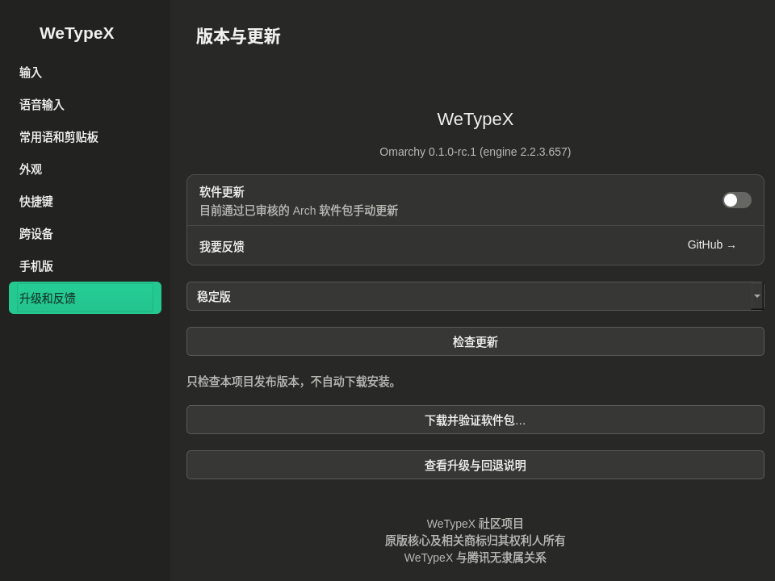

# Native desktop applications

The packaged applications now use the real existing settings/account and transfer backends. They are distinct from `demo/desktop`, which remains a synthetic interaction prototype. The first native-GUI package is a release candidate; offline GUI tests cannot certify official-device interoperability.

## Settings

Launch **WeTypeX Settings** from the application launcher or run `fcitx5-wetypex-settings`. The window is decorated, resizable and uses an opaque dark palette (`#282827`, accent `#24C891`). `Ctrl+1` through `Ctrl+8` select pages; `Esc` closes the window. The compositor may still apply its own opacity/placement policy. No Hyprland configuration is changed automatically.

Existing input options, including all supported fuzzy-pinyin pairs, retain their original backend mapping. Changes save immediately; unsupported controls remain disabled. Atomic JSON writes preserve unknown keys and refuse malformed existing settings. Failed toggle writes revert visibly. Other controls report write failures; reopen the page to reload persisted values. The appearance controls change the Fcitx candidate theme, not the desktop's global theme.

Opening settings no longer starts an engine to load common phrases. Use **Load / refresh phrases** explicitly. Phrase operations run outside the GUI thread and have bounded backend waits. The interface remains responsive to engine startup/failure. A request already submitted may finish after its dialog is closed; reload phrases to establish the actual state before retrying. The operating system's microphone list is discovered asynchronously without recording audio.

Device sync switches retain the last server-acknowledged state when a request fails. Pairing remains an explicit official association operation. Existing identities are reused, never copied. Reopen settings after pairing to reload the current device/sync snapshot. The GUI is not a service manager: independent sync activation is still performed through the documented setup command.

In **Versions and updates**, select stable or preview, then check explicitly. **Download and verify package** uses the installed package helper and GitHub release attestations; it does not install or restart anything. `github-cli` with `release verify` / `release verify-asset`, network access and any authentication required by GitHub CLI are prerequisites. Existing download directories are preserved rather than overwritten. See [updates](UPDATES.md).

## File transfer

Launch **WeTypeX File Transfer** or run `wetypex-files`.

1. Refresh associated devices. A listed device is not necessarily online.
2. Select local regular files, or drop them into the window. Duplicate canonical paths are collapsed; selection is limited to 100 files. Selection alone never transmits. Directory uploads are intentionally omitted from this first native workflow; choose individual files.
3. Select a device and choose **Connect and send**, or **Connect / receive files** for a receive session. QR connection remains available. An invitation is not a completed connection.
4. After the real backend reports connection, queued outgoing files are submitted serially. The task list records each direction, progress and result. The next file waits for the previous backend completion/error.
5. The actual receive directory is displayed with an open-folder action. A receive is shown as saved only after a successful backend completion and a local regular-file size/path check within that directory. This is not a cryptographic comparison with the sender. Outgoing completion means the sending backend reported success; confirm the file on the peer.

**Receiving consent is session-wide:** once you explicitly connect, the existing backend automatically saves incoming files from that peer. It does not expose per-file invitation acceptance/rejection. This GUI does not invent those controls. Close or disconnect when finished.

**Stop all tasks** disconnects the real transport. Closing a connected window asks first. A connection deadline and a two-minute no-progress transfer deadline prevent an indefinite busy state. Interrupted outgoing selections return to the pending list; reselect/reconnect explicitly. Cancellation does not imply that a peer deleted a file already received, and partial files must not be considered complete. Late account replies from an older session cannot revive a stopped session. An activity timeout is a recovery policy, not a throughput/latency promise.

Each user has one settings instance and one transfer instance. Reopening requests activation of the existing window; final focus/placement remains controlled by the compositor. Transfers end when the window/process ends. No separate persistent transfer daemon is introduced.

Direct cross-device `.md` / `.pdf` file copy-and-paste is not implemented. The file chooser and drag/drop send path require an explicit send action.

## Validation and rollout

Automated tests exercise actual settings construction under empty XDG directories, absence of startup writes/engine initialization, asynchronous failure, damaged-config preservation, file selection, process-backed synthetic upload events, per-file results, verified receive size, terminal stop and retry selection. Images in this guide are synthetic previews, not evidence of real transfer.

Native desktop mapping was observed on the maintenance machine without replacing the live input method. The candidate still requires real typing, settings persistence, file transfer with both official clients, disconnect/cancel, and upgrade/restart acceptance. Historical protocol success from earlier builds is recorded separately in the README.
